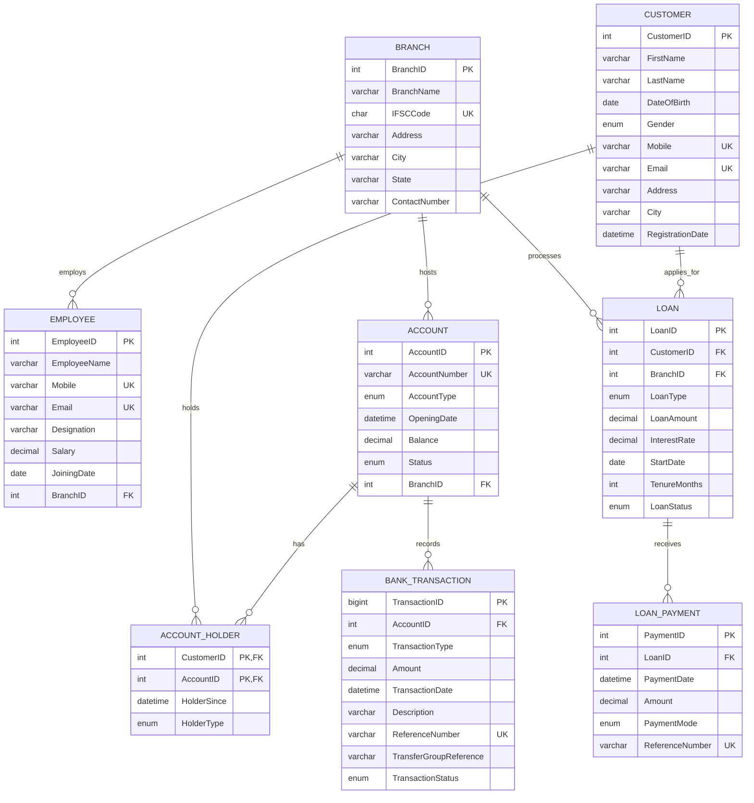

# Entity-Relationship Diagram

The diagram below is the logical ER model of the implemented `project_kashi` database. It matches `sql/schema.sql`.

## ER model versus relational schema

An **ER model** describes entities, attributes, and business relationships at a conceptual level. It does not include physical storage details. The **relational schema** is the physical implementation: tables, column data types, primary keys, foreign keys, unique constraints, checks, defaults, and indexes.

- The ER model shows CUSTOMER and ACCOUNT as related.
- The relational schema implements that many-to-many relationship as the `ACCOUNT_HOLDER` junction table with the composite primary key `(CustomerID, AccountID)`.

## Why ACCOUNT_HOLDER is required

One customer can own several accounts, and one account can be shared by several customers (for example, a primary holder and a joint holder). A many-to-many relationship cannot be stored in either CUSTOMER or ACCOUNT without repeating data or limiting the relationship. `ACCOUNT_HOLDER` resolves it:

- Each row links exactly one customer to exactly one account.
- The composite primary key prevents the same customer from being linked twice to the same account.
- `HolderType` records whether the holder is `Primary` or `Joint`.
- A trigger enforces at most one `Primary` holder per account.

## Entities at a glance

| Entity | Logical table | Purpose |
|---|---|---|
| BRANCH | `BRANCH` | Bank branch master data and IFSC. |
| CUSTOMER | `CUSTOMER` | Person who uses banking services. |
| EMPLOYEE | `EMPLOYEE` | Staff member assigned to a branch. |
| ACCOUNT | `ACCOUNT` | Bank account with type, balance, and status. |
| ACCOUNT_HOLDER | `ACCOUNT_HOLDER` | Junction between customers and accounts. |
| TRANSACTION | `BANK_TRANSACTION` | Immutable financial activity record. |
| LOAN | `LOAN` | Loan application and lifecycle status. |
| LOAN_PAYMENT | `LOAN_PAYMENT` | Payment made against a loan. |

`BANK_TRANSACTION` is used as the physical table name because `TRANSACTION` is a reserved SQL keyword. The logical entity name remains TRANSACTION.
