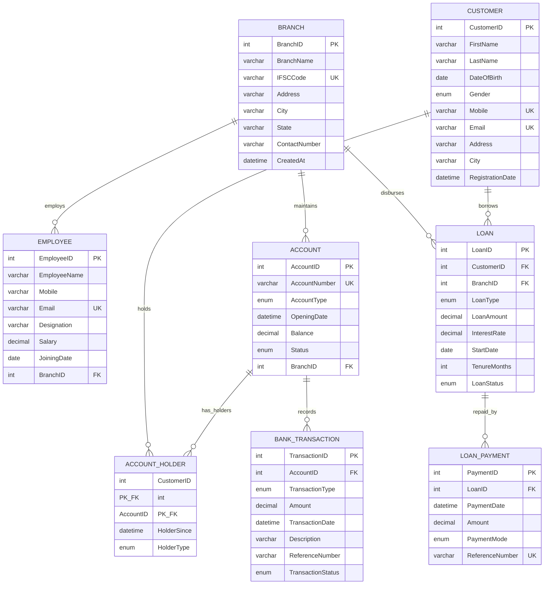

# Entity-Relationship (ER) Diagram — Project Kashi

This document contains the visual and logical Entity-Relationship architecture of **Project Kashi — Banking Management System**.

---

## 1. Visual Mermaid ER Diagram

The following Mermaid diagram renders natively in GitHub Markdown viewers and VS Code:

---

## 2. Distinction Between ER Diagram and Relational Schema

| Dimension | Conceptual ER Diagram | Relational Schema |
| :--- | :--- | :--- |
| **Abstraction Level** | High-level conceptual model focusing on business entities and associations. | Logical and physical implementation model ready for RDBMS storage. |
| **Representation of M:N Relationships** | Drawn directly as a diamond relationship connecting two entities (e.g., `CUSTOMER` holds `ACCOUNT`). | Decomposed into an associative/bridge table (`ACCOUNT_HOLDER`) with foreign keys. |
| **Attributes** | Outlined as ellipses or logical property lists without implementation specifics. | Defined with strict MySQL data types (`INT`, `VARCHAR(50)`, `DECIMAL(15,2)`, `DATETIME`). |
| **Integrity Rules** | Outlined as business constraints. | Enforced via `PRIMARY KEY`, `FOREIGN KEY`, `CHECK`, `UNIQUE`, `NOT NULL`, and cascading actions (`ON UPDATE CASCADE`). |

---

## 3. Why `ACCOUNT_HOLDER` is Required to Represent Many-to-Many

In modern retail banking:
1. **Multiple accounts per customer**: A customer can hold both a Savings Account and a Current Account.
2. **Multiple customers per account**: Spouses or business partners can operate a single **Joint Account**.

If we placed `CustomerID` directly inside `ACCOUNT`, an account could only ever belong to **one** customer (disallowing Joint accounts). Conversely, placing `AccountID` inside `CUSTOMER` would prevent a customer from holding multiple accounts unless we violated First Normal Form (1NF) with a multi-valued repeating column.

Therefore, the associative entity **`ACCOUNT_HOLDER`** bridges `CUSTOMER` and `ACCOUNT` using a composite primary key `(CustomerID, AccountID)` and supports an attribute `HolderType` (`Primary` vs `Joint`).
