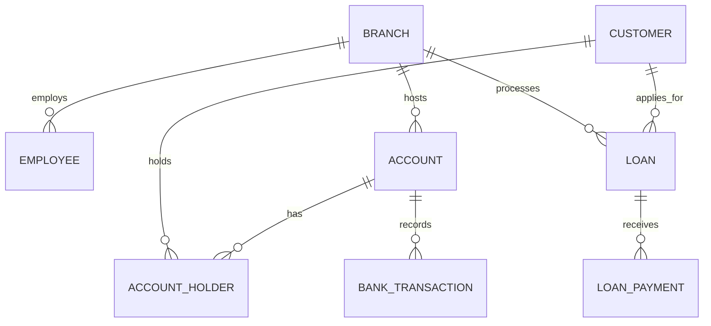

# Project Kashi - Banking Management System

## Project Report

**Course:** Database Management Systems (DBMS)
**Programme:** B.Tech Computer Science Engineering
**Technology:** Python Flask, MySQL 8.0, HTML, CSS, JavaScript
**Submission date:** 28 October 2026

---

## 1. Title

Project Kashi - Banking Management System: A DBMS and Flask web application for customers, branches, employees, accounts, transactions, loans, and loan payments.

## 2. Abstract

Project Kashi is a local academic banking management system. It stores customer, branch, employee, account, transaction, loan, and payment data in a normalized MySQL 8.0 database and exposes it through a Flask web application with raw HTML and CSS. The project demonstrates entity-relationship modelling, primary and foreign keys, unique and check constraints, many-to-many resolution, joins, aggregate queries, views, stored functions, stored procedures, triggers, row locking, and ACID transaction handling. Money operations update the account balance and insert a transaction record in one commit or roll back together. The application is a simulation intended for demonstration and viva, not a production banking platform.

## 3. Introduction

Banks must record who owns an account, where the account is held, which transaction changed a balance, and how a loan is repaid. A spreadsheet cannot reliably enforce keys, balances, or concurrency. A relational database management system provides structure, constraints, and transactional guarantees.

This project implements those ideas in a small but complete application. A user can register a customer, open an account, deposit, withdraw, transfer funds, view history, manage branches and employees, and process a basic loan workflow. Every displayed value comes from MySQL.

## 4. Problem Statement

A manual or unnormalized banking record system suffers from duplicate customers, inconsistent branch spelling, lost transaction history, negative balances, unclear loan status, and unsafe concurrent updates. The problem is to design a normalized relational database and a Flask front end that enforce data integrity and perform money movements atomically.

## 5. Objectives

1. Design an ER model for eight core entities and document cardinalities.
2. Implement the schema in MySQL 8.0 with keys, checks, defaults, and indexes.
3. Normalize the data to third normal form with justified controlled denormalization for balance.
4. Build Flask routes and Jinja pages for the required banking workflows.
5. Use parameterized SQL and server-side validation throughout.
6. Demonstrate ACID transactions, row locking, commit, and rollback.
7. Provide views, stored functions, stored procedures, triggers, and business queries.
8. Test the application with an automated suite and document the results.
9. Prepare a GitHub-ready repository with setup, report, and viva material.

## 6. Scope

**Included:** local Flask application, MySQL schema and sample data, customer/account/transaction/loan workflows, reporting SQL, automated tests, documentation.

**Not included:** login and role management, real money, payment gateways, interest accrual schedules, statement PDF export, emails/SMS, external APIs, deployment, production security, and regulatory compliance.

## 7. Technology Stack

| Layer | Technology | Reason |
|---|---|---|
| Backend | Python 3.10+, Flask 3.1 | Small, readable, suitable for academic work. |
| Database | MySQL 8.0, InnoDB | Required relational DBMS with transactions, triggers, and routines. |
| Connector | mysql-connector-python | Parameterized SQL and stored procedure support. |
| Frontend | Raw HTML, CSS, vanilla JavaScript | Beginner-friendly and framework-free. |
| Templates | Jinja2 | Server rendering of database rows with autoescaping. |
| Forms | Flask-WTF CSRF | Protects POST requests. |
| Config | python-dotenv | Keeps credentials out of source code. |
| Tests | pytest | Automated route and database tests. |

## 8. System Architecture

```text
User browser
   |  HTML forms and links
Flask application (app.py)
   |  validation and business rules
Database helper (db.py) -- configuration (config.py/.env)
   |  parameterized SQL and transactions
MySQL 8.0 (project_kashi)
   |  tables, keys, checks, views, routines, triggers, InnoDB locks
Storage
```

## 9. Three-Layer Application Architecture

1. **Presentation layer** - Jinja templates in `templates/`, `static/css/style.css`, and `static/js/main.js`. It only displays data and sends requests.
2. **Application layer** - `app.py` routes, validation helpers, transaction blocks, flash messages, and redirects. It never trusts the browser.
3. **Data layer** - MySQL tables and database objects. It is the final authority on keys, constraints, and atomicity.

## 10. ER Diagram

The ER model contains BRANCH, CUSTOMER, EMPLOYEE, ACCOUNT, ACCOUNT_HOLDER, BANK_TRANSACTION, LOAN, and LOAN_PAYMENT. Mermaid source is in `docs/ER_DIAGRAM.mmd` and rendered documentation is in `docs/ER_DIAGRAM.md`.



## 11. Entity Definitions

| Entity | Meaning | Logical table |
|---|---|---|
| BRANCH | A bank branch with IFSC and contact details. | `BRANCH` |
| CUSTOMER | A person registered with the bank. | `CUSTOMER` |
| EMPLOYEE | A staff member of one branch. | `EMPLOYEE` |
| ACCOUNT | A bank account with type, balance, and status. | `ACCOUNT` |
| ACCOUNT_HOLDER | The link between a customer and an account. | `ACCOUNT_HOLDER` |
| TRANSACTION | A financial movement on an account. | `BANK_TRANSACTION` |
| LOAN | A loan application and its lifecycle status. | `LOAN` |
| LOAN_PAYMENT | A payment against a loan. | `LOAN_PAYMENT` |

## 12. Attribute Definitions

Full attribute descriptions are in `docs/DATA_DICTIONARY.md`. Key attributes include customer identity and contact fields, branch IFSC, employee designation and salary, account number/type/balance/status, holder type and since-date, transaction type/amount/date/reference/status, loan type/amount/interest/tenure/status, and payment amount/mode/reference.

## 13. Data Types

- Surrogate identifiers: `INT AUTO_INCREMENT` (`BIGINT` for transactions and payments where applicable).
- Names and addresses: `VARCHAR`.
- IFSC: `CHAR(11)`.
- Dates: `DATE`; timestamps: `DATETIME` with `CURRENT_TIMESTAMP` defaults.
- Money: `DECIMAL(15,2)`; salary `DECIMAL(12,2)`; interest `DECIMAL(5,2)`.
- Controlled values: `ENUM` for gender, account type, account status, transaction type, transaction status, loan type, loan status, holder type, and payment mode.

## 14. Primary Keys

Every table has a primary key. `ACCOUNT_HOLDER` uses the composite primary key `(CustomerID, AccountID)`. Surrogate keys are generated by MySQL and never typed by the user.

## 15. Foreign Keys

| Child | Column | Parent |
|---|---|---|
| EMPLOYEE | BranchID | BRANCH |
| ACCOUNT | BranchID | BRANCH |
| ACCOUNT_HOLDER | CustomerID | CUSTOMER |
| ACCOUNT_HOLDER | AccountID | ACCOUNT |
| BANK_TRANSACTION | AccountID | ACCOUNT |
| LOAN | CustomerID | CUSTOMER |
| LOAN | BranchID | BRANCH |
| LOAN_PAYMENT | LoanID | LOAN |

All use `ON UPDATE CASCADE ON DELETE RESTRICT`.

## 16. Constraints

- PRIMARY KEY on every table.
- FOREIGN KEY with restrictive deletes.
- UNIQUE on customer mobile/email, employee mobile/email, IFSC, account number, transaction reference, and payment reference.
- NOT NULL on required business fields.
- CHECK on balance `>= 0`, amount `> 0`, salary `> 0`, interest 0-50, tenure 1-600, IFSC/mobile formats, email shape, and date bounds.
- DEFAULT on registration time, opening time, transaction time, payment time, balance, and statuses.
- A transfer-reference check ensures TRANSFER_IN/TRANSFER_OUT rows have a `TransferGroupReference` while DEPOSIT/WITHDRAWAL rows do not.

## 17. Relationships and Cardinalities

| Relationship | Cardinality | Implementation |
|---|---|---|
| BRANCH - EMPLOYEE | One-to-many | `EMPLOYEE.BranchID` |
| BRANCH - ACCOUNT | One-to-many | `ACCOUNT.BranchID` |
| CUSTOMER - ACCOUNT | Many-to-many | `ACCOUNT_HOLDER` bridge |
| CUSTOMER - LOAN | One-to-many | `LOAN.CustomerID` |
| BRANCH - LOAN | One-to-many | `LOAN.BranchID` |
| ACCOUNT - BANK_TRANSACTION | One-to-many | `BANK_TRANSACTION.AccountID` |
| LOAN - LOAN_PAYMENT | One-to-many | `LOAN_PAYMENT.LoanID` |

Details and participation rules are in `docs/RELATIONSHIPS_AND_CARDINALITY.md`.

## 18. Relational Schema

The relational schema is documented in `docs/RELATIONAL_SCHEMA.md` and implemented in `sql/schema.sql`. It converts the many-to-many customer-account relationship into the junction table `ACCOUNT_HOLDER`.

## 19. Normalization

The project is documented to 3NF in `docs/NORMALIZATION.md`:

- **1NF:** atomic columns; transactions and joint holders are separate rows.
- **2NF:** `HolderSince` and `HolderType` depend on both parts of the composite key.
- **3NF:** branch and customer descriptions are not repeated in account or transaction rows.

`ACCOUNT.Balance` is a deliberate controlled denormalization for fast, locked updates. It is always changed together with its transaction row inside one transaction.

## 20. Database Implementation

`sql/schema.sql` drops and recreates `project_kashi` and creates the eight tables in foreign-key-safe order: BRANCH, CUSTOMER, EMPLOYEE, ACCOUNT, ACCOUNT_HOLDER, BANK_TRANSACTION, LOAN, LOAN_PAYMENT. It adds named constraints and indexes. `sql/sample_data.sql` loads fictional demonstration data. Views, functions, procedures, and triggers are created by their own scripts.

## 21. Flask Backend Implementation

`app.py` defines the routes, validation helpers (`parse_money`, `parse_date_value`, `parse_record_id`), template filters, error handlers, and transaction workflows. `db.py` provides `query_all`, `query_one`, `execute`, `execute_many`, `transaction`, `call_procedure`, and `check_connection`. `config.py` loads `.env` settings.

Money routes use explicit transaction blocks:

```python
with transaction() as (conn, cur):
    cur.execute("SELECT Balance, Status FROM ACCOUNT WHERE AccountID = %s FOR UPDATE", (account_id,))
    ...
```

The context manager commits when the block succeeds and rolls back when any exception is raised.

## 22. HTML Frontend Implementation

Jinja templates extend `base.html`, which provides the navigation, flash messages, footer, and asset links. Pages include dashboard, customer list/form/detail, account list/form/detail, deposit, withdrawal, transfer, transaction history, branches/form, employees/form, loans/form/detail, loan payments, error, and 404. Tables, forms, status badges, search inputs, and empty states are styled in `static/css/style.css`. JavaScript only handles the mobile menu, confirmation prompts, alert auto-hide, transfer same-account pre-check, and date limits.

## 23. Database Connectivity

`db.py` reads connection values from the Flask configuration, which comes from `.env`. Connections are opened for a request operation and closed in `finally` blocks. Connections are created with `autocommit=False`; the transaction helper calls `start_transaction()`, commits on success, and rolls back on error. `check_connection()` is used by `/health` and at startup for a clear warning if MySQL is unreachable.

## 24. Customer Registration Workflow

1. User opens `/customers/new`.
2. Flask validates name, date of birth, gender, mobile, email, address, and city.
3. A parameterized `INSERT INTO CUSTOMER` runs.
4. Unique constraints protect mobile and email.
5. Success redirects to `/customers`; errors re-render the form with a flash message.
6. The detail page reads the row back from MySQL and lists any accounts and loans.

## 25. Account-Opening Workflow

1. The form lists customers and branches from the database.
2. Flask validates the selected IDs, account type, holder type, and initial deposit.
3. A 12-digit account number is generated with the `secrets` module.
4. One transaction inserts ACCOUNT, inserts ACCOUNT_HOLDER, and optionally inserts an opening DEPOSIT.
5. Any error rolls back the whole operation, so no half-opened account remains.
6. The success message shows the generated account number.

## 26. Deposit Workflow

The account row is locked with `SELECT ... FOR UPDATE`. Flask checks that the account exists and is Active, increases `Balance`, inserts a `DEPOSIT` row with a unique reference and `SUCCESS` status, and commits. A failure rolls back both changes. The database check `Balance >= 0` and the application both protect balance integrity.

## 27. Withdrawal Workflow

The flow is the same as deposit, but Flask checks that the balance is sufficient and that the new balance would not be negative before subtracting. Insufficient funds raise a business error and the whole transaction rolls back. The failed attempt is rejected rather than stored as a silent balance change.

## 28. Transfer Workflow

1. Flask validates two distinct account IDs and a positive amount.
2. Both account rows are locked in ascending AccountID order in one `FOR UPDATE` query to reduce deadlock risk.
3. Both accounts must exist and be Active.
4. The source balance must be sufficient.
5. Both balances are updated.
6. `TRANSFER_OUT` and `TRANSFER_IN` rows are inserted with unique references and a shared `TransferGroupReference`.
7. One commit saves all four changes; any error rolls back all of them.

## 29. SQL Business Queries

`sql/business_queries.sql` contains 18 queries. `docs/BUSINESS_PROBLEMS.md` documents each business question, SQL, purpose, DBMS concepts, and expected columns. They demonstrate joins, LEFT JOIN, GROUP BY, HAVING, aggregate functions, subqueries, conditional aggregation, and date formatting.

## 30. Views

Six views are created in `sql/views.sql`:

- `vw_customer_account_summary`
- `vw_account_details`
- `vw_account_transaction_history`
- `vw_branch_summary`
- `vw_loan_payment_summary`
- `vw_customer_loan_summary`

They simplify repetitive reporting joins. The dashboard and several pages use `vw_branch_summary` and `vw_loan_payment_summary`.

## 31. Stored Functions

`sql/functions.sql` creates:

- `fn_customer_age(customer_id)` - customer age in years.
- `fn_account_tenure_months(account_id)` - account age in months.
- `fn_loan_outstanding(loan_id)` - loan amount minus payments.
- `fn_branch_total_balance(branch_id)` - total active-account balance for a branch.

They are declared `READS SQL DATA` and return `NULL` when the referenced row does not exist.

## 32. Stored Procedures

`sql/procedures.sql` creates:

- `sp_customer_accounts(customer_id)` - accounts held by a customer.
- `sp_account_statement(account_id, from_date, to_date)` - date-filtered statement.
- `sp_branch_summary()` - branch report from the view.
- `sp_approve_loan(loan_id, result)` - locks and approves a Pending loan.

Inputs are parameters; no string concatenation of user input is used.

## 33. Triggers

`sql/triggers.sql` creates eight triggers:

| Trigger | Event | Purpose |
|---|---|---|
| `trg_account_status_before_update` | BEFORE UPDATE ACCOUNT | Block reopening a closed account and closing with a non-zero balance. |
| `trg_account_holder_primary_before_insert` | BEFORE INSERT ACCOUNT_HOLDER | Only one Primary holder per account. |
| `trg_account_holder_primary_before_update` | BEFORE UPDATE ACCOUNT_HOLDER | Same rule on update. |
| `trg_transaction_before_insert` | BEFORE INSERT BANK_TRANSACTION | Only Active accounts can receive transactions. |
| `trg_transaction_prevent_update` | BEFORE UPDATE BANK_TRANSACTION | Immutable history. |
| `trg_transaction_prevent_delete` | BEFORE DELETE BANK_TRANSACTION | Immutable history. |
| `trg_loan_payment_before_insert` | BEFORE INSERT LOAN_PAYMENT | Only Approved loans; no overpayment. |
| `trg_loan_payment_after_insert` | AFTER INSERT LOAN_PAYMENT | Close the loan when fully paid. |

The triggers never update account balances, because Flask already updates them inside the same transaction. This avoids double counting and circular trigger logic.

## 34. ACID Properties and Transactions

- **Atomicity:** account opening, deposit, withdrawal, transfer, loan payment, and status updates use one transaction. All statements succeed or none are saved.
- **Consistency:** constraints and business rules keep balances non-negative, amounts positive, references unique, and statuses valid.
- **Isolation:** `SELECT ... FOR UPDATE` locks rows so concurrent operations read a stable balance. Transfers lock in a consistent order.
- **Durability:** `COMMIT` writes changes to InnoDB storage and the transaction log. The balance is read from MySQL, not memory.

## 35. Security Considerations

Implemented:
- Parameterized SQL for every user value.
- Server-side validation before SQL.
- Jinja autoescaping of all displayed data.
- POST for state-changing operations.
- CSRF tokens on all forms through Flask-WTF.
- Credentials in environment variables; `.env` ignored by Git.
- Friendly user messages; database errors logged instead of printed.
- Row locking and rollback.
- No unrestricted balance-edit form.

Not implemented and not claimed: authentication, roles, authorization, HTTPS deployment, rate limiting, audit login, encryption at rest, and production monitoring.

## 36. Testing and Results

The automated suite has 23 tests covering startup, dashboard, customer creation and duplicates, account opening and holders, deposit, withdrawal, insufficient balance, invalid amounts, transfer success and rollback, same-account transfer, transaction history, branch/employee creation, loan workflow, triggers, views, functions, and procedures.

Actual command and result:

```text
python -m pytest -q
23 passed, 4 warnings in 10.85s
```

The tests ran against an isolated MySQL 8.0.46 instance with a dedicated `project_kashi_test` database. Details and manual cases are in `docs/TEST_CASES.md`.

## 37. Screenshots

No screenshots were captured in the build environment. `docs/SCREENSHOTS.md` lists 15 required screenshots and the MySQL queries to display. Save real captures in `screenshots/`. Screenshot images must be produced from the running application and must not be fabricated.

## 38. Limitations

- No authentication or role-based access. Anyone who can open the app can perform transactions.
- No real payment gateway or bank integration.
- No interest accrual schedule, EMI generation, or penalty calculation.
- Loans have a simple Pending/Approved/Rejected/Closed workflow only.
- No statement PDF/CSV export.
- No pagination on very large tables.
- Balance is a stored controlled denormalization rather than a computed sum.
- The application is configured for local development, not production scaling.
- Screenshots and personal MySQL credentials are not included.

## 39. Future Enhancements

- Login with hashed passwords and roles for teller, manager, and auditor.
- EMI schedules, interest posting, and penalty handling.
- PDF/CSV statements and email/SMS notifications.
- Audit log table for every status and data change.
- Pagination, advanced date filters, and charts.
- Soft-delete or archival strategy with database backups.
- Deployment with HTTPS, a WSGI server, and environment-specific configuration.
- More automated tests, including concurrency tests for transfers.

## 40. Conclusion

Project Kashi shows how a normalized MySQL database and a small Flask application work together to support banking operations safely. It demonstrates ER modelling, keys, constraints, many-to-many resolution, joins, aggregation, views, stored routines, triggers, transactions, locking, and rollback. Money operations are atomic, transaction history is immutable, and all dashboard values come from the database. The project meets the academic objectives and provides a clear base for the viva and for future enhancement, while remaining honest about its limitations as a simulation rather than a production banking system.
